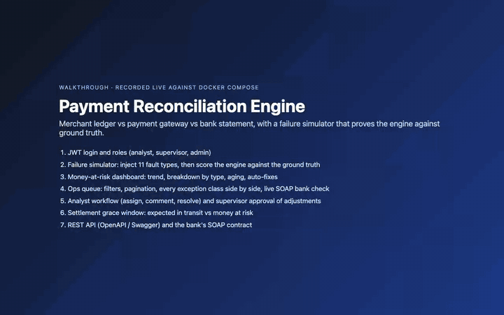
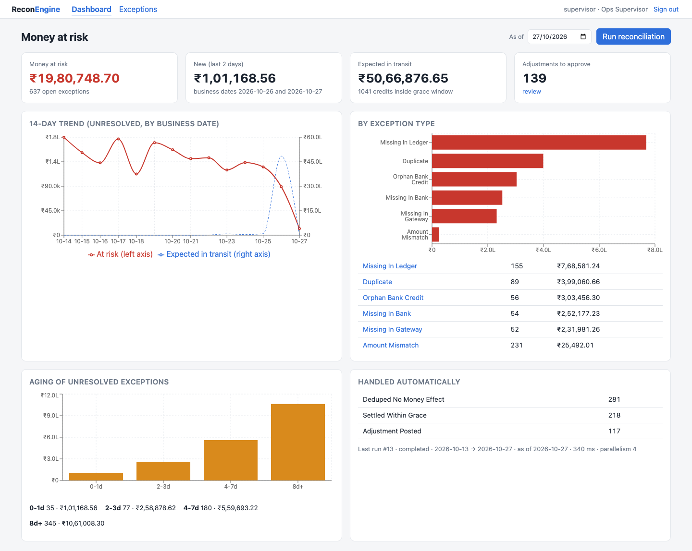
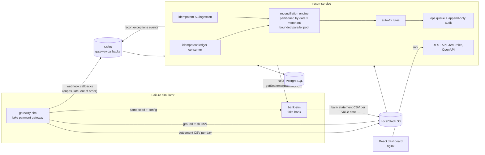
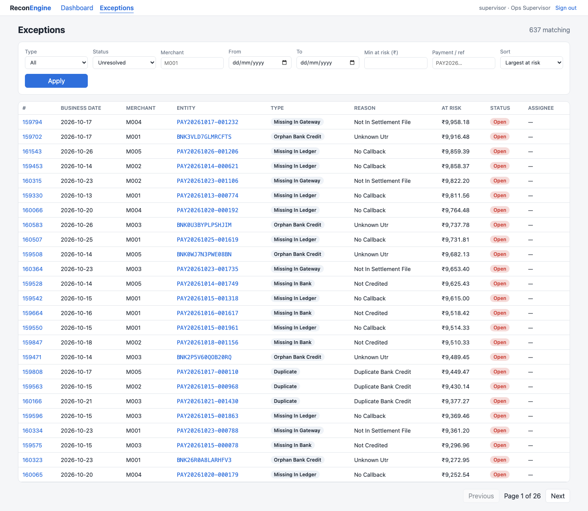
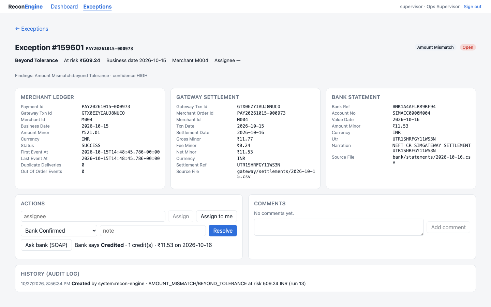
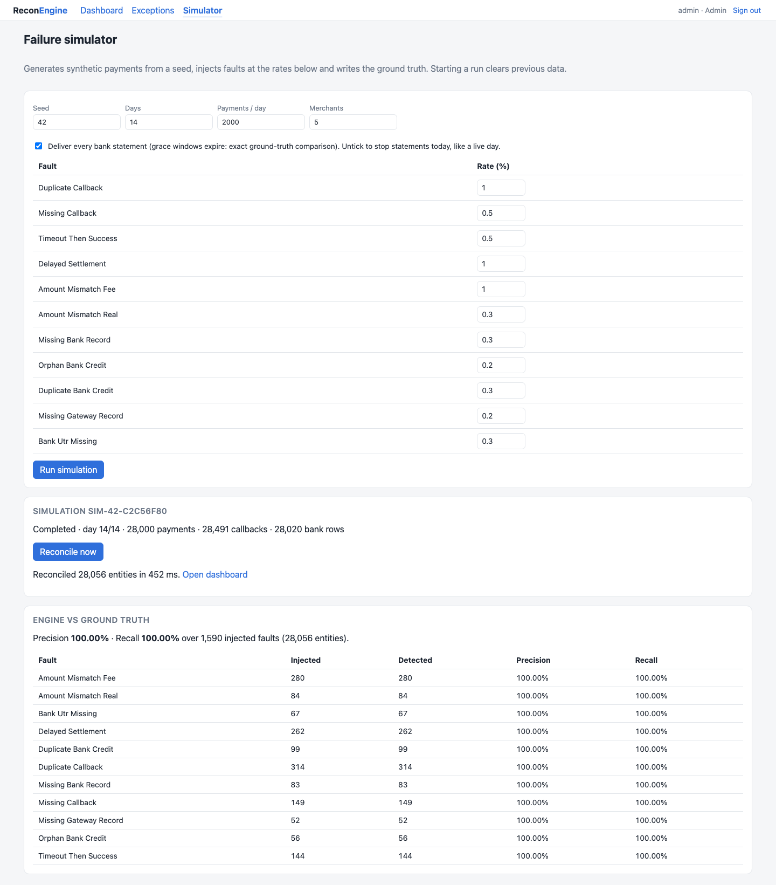
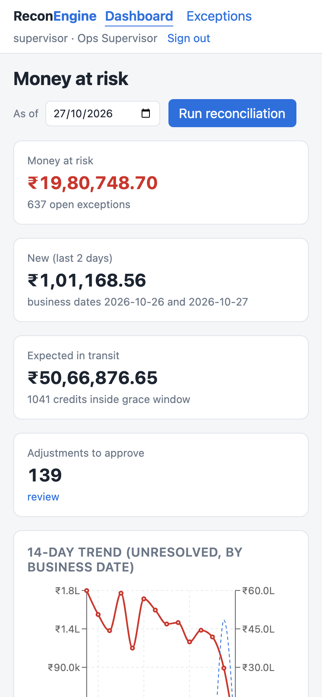

# payment-reconciliation-engine

[](https://github.com/himanshu-0807/payment-reconciliation-engine/actions/workflows/ci.yml)

A merchant sees every digital payment three times. Its own **ledger** is built from the gateway's
webhook callbacks. The **gateway's settlement file** says what the gateway captured and paid out,
net of fees. The **bank statement** says what actually arrived. These three record sets drift
apart: callbacks are lost, duplicated or arrive out of order; fees get re-rounded; settlements
arrive late, twice or not at all; and some credits match nothing. This engine reconciles the three
sources, classifies the cause of every mismatch, auto-fixes the cases that are safe to fix (with an
append-only audit trail), routes the rest to an ops queue, and keeps a daily **money at risk**
figure. It ships with a deterministic failure simulator: a fake gateway and a fake bank that
misbehave on purpose, plus a ground-truth file. That lets the engine's findings be measured against
the injected faults instead of eyeballed.

All data is synthetic, everything runs locally and for free, and every number below was measured.

## Video walkthrough

[](docs/video/walkthrough.mp4)

The GIF above plays at 4× speed. **[Watch the full walkthrough (MP4, 3 min 33 s, 10 MB)](docs/video/walkthrough.mp4)**.
It was recorded live against `docker compose up`, with on-screen captions for each step:

1. JWT login: a wrong password is rejected, then roles (analyst, supervisor, admin)
2. Failure simulator: set seed, volume and fault rates; callbacks go to Kafka, files to S3; reconcile; **engine vs ground truth: 100% precision and recall per fault type**
3. Money-at-risk dashboard: KPIs, 14-day trend, breakdown by exception type, aging buckets, auto-fixes
4. Ops queue: filters (type, minimum amount, sort), server-side pagination
5. Every exception class with ledger, gateway and bank records side by side: missing in ledger, missing in gateway, missing in bank (live SOAP check: NOT_FOUND), duplicate bank credit (SOAP: DUPLICATE_CREDIT), real amount mismatch, orphan credit, late settlement auto-resolved, duplicate callback deduped
6. Analyst: cannot run reconciliation or approve adjustments; works a case (assign, comment, resolve) and the audit trail records each step
7. Supervisor approves a fee adjustment above ₹0.50, then re-runs reconciliation, which changes nothing (idempotent)
8. A live day with bank statements stopping today: grace window, "expected in transit" vs money at risk, `PENDING_EXPECTED` cases
9. REST API in Swagger UI and the bank's SOAP WSDL

Re-record it with `cd web && node scripts/demo-video.mjs && ../scripts/make-video.sh`; the stack must be running and the demo passwords exported from `.env`.



## Measured results

| What | Result | How to reproduce |
|---|---|---|
| Ground truth, full docker compose stack (7 days × 20,000 payments, 7,762 injected faults) | **precision 1.0, recall 1.0** | `scripts/ground-truth.sh 7 20000 42` |
| Ground truth at scale (14 days × 100,000 payments, 78,309 injected faults) | **precision 0.999949, recall 0.999974**. Four mismatches, all from one ambiguous amount collision that the engine deliberately refuses to guess ([why](docs/BENCHMARKS.md#ground-truth-at-scale)) | `scripts/benchmark.sh 14 100000 20260901` |
| Reconcile 1,402,802 entities (95 partitions) | **38.3 s at parallelism 1, 16.9 s at parallelism 8** | same |
| Same results at any parallelism | identical SHA-256 result digest at p=1, at p=8 and on a re-run at 1.4M entities; the integration test also compares full tables | same, plus `ReconEngineIT` |
| End-to-end ingest (1.4M payments) | simulation 12.4 s; Kafka ledger caught up 22.8 s after simulation start (≈ 62k callbacks/s); 2.8M file rows from S3 in 43.1 s | same |
| Peak memory at scale | recon-service 941 MiB resident (767 MiB heap used), Postgres 771 MiB, Kafka 855 MiB | same |
| Tests | 79 backend tests (61 that need no Docker, 18 integration tests on Testcontainers Postgres + Kafka) and 38 frontend tests (Jest + React Testing Library), all passing | `mvn verify`, `cd web && npm test` |

Hardware, method and caveats: [docs/BENCHMARKS.md](docs/BENCHMARKS.md). For the scale run, the
Java services ran as host JVMs and the infrastructure ran in Docker Desktop on an Apple Silicon Mac
with 10 cores.

## Architecture



## Run it

Requirements: Docker (Compose v2), `curl` and `jq`. The demo needs nothing else installed.

```sh
git clone https://github.com/himanshu-0807/payment-reconciliation-engine.git
cd payment-reconciliation-engine
scripts/demo.sh
```

`scripts/demo.sh` copies `.env.example` to `.env` if needed and runs `docker compose up -d --build`
for the whole system (Postgres, Kafka in KRaft mode, LocalStack, gateway-sim, bank-sim,
recon-service and the dashboard). It then simulates 14 days × 2,000 payments with the default fault
rates, reconciles, and prints the money-at-risk summary. Open the dashboard at
<http://localhost:3000> and sign in as `analyst`, `supervisor` or `admin`; the passwords are in
`.env`. Swagger UI is at <http://localhost:8080/swagger-ui.html>.

To bring the stack up without the demo: `cp .env.example .env && docker compose up -d --build`.
Host ports used: 3000 (web), 8080–8082 (services), 5433 (Postgres), 9094 (Kafka), 4566 (LocalStack).

Other scripts in [`scripts/`](scripts/), all POSIX `sh`:

| Script | What it does |
|---|---|
| `health-check.sh` | container health, readiness of every service, SOAP WSDL, Kafka topic, S3 bucket, Postgres |
| `seed.sh [days] [perDay] [seed] [ratesJson]` | start a simulation with custom fault rates |
| `ground-truth.sh [days] [perDay] [seed]` | simulate with every statement delivered, reconcile, and print precision and recall per fault |
| `benchmark.sh [days] [perDay] [seed]` | the scale benchmark (JSON written to `bench-results/`) |
| `log-check.sh` | grep/awk summary of service logs: levels, ledger duplicates absorbed, ingestion, runs, stack traces |
| `make-video.sh` | turns the Playwright walkthrough recording (`web/scripts/demo-video.mjs`) into `docs/video/walkthrough.mp4` and the GIF preview |

Building from source needs Java 21, Maven 3.9 and Node 22: run `mvn verify` (Docker must be running
for Testcontainers), and `cd web && npm ci && npm test`.

## Screenshots

Captured with Playwright against the running demo (`web/scripts/screenshots.mjs`).

| | |
|---|---|
|  |  |
| Exceptions with filters and pagination | Ledger, gateway and bank records side by side, actions, live SOAP check |
|  |  |
| Simulator control and engine vs ground truth | Dashboard at phone width |

## What it does

- **Three-way matching.** `payment_id ↔ merchant_order_id` (or `gateway_txn_id`), and
  `settlement_ref ↔ UTR`. When keys are missing, it falls back to amount + merchant + date window,
  only if the match is mutually unique, and marks those matches `LOW_CONFIDENCE`.
- **Classes:** `MATCHED`, `MISSING_IN_LEDGER`, `MISSING_IN_GATEWAY`, `MISSING_IN_BANK`,
  `DUPLICATE`, `AMOUNT_MISMATCH`, `LATE_SETTLEMENT`, `ORPHAN_BANK_CREDIT`, with a documented
  precedence for payments that have several problems ([DESIGN.md](docs/DESIGN.md#classification-and-precedence)).
- **Auto-fix:** dedupe duplicate callbacks; hold missing credits as `PENDING_EXPECTED` until the
  T+5 grace window expires, then escalate; post fee/rounding adjustments of ₹1.00 or less to an
  adjustment journal, with supervisor approval required above ₹0.50. Every action is in an audit log
  that a database trigger keeps append-only.
- **Ops queue:** `OPEN → IN_REVIEW → RESOLVED`, with assignee, comments, resolution reasons, and
  adjustment approval by `OPS_SUPERVISOR`.
- **Idempotent everywhere:** a dedupe table keyed by event id plus Kafka position, file checksums
  and natural keys, and per-partition replace. Re-running the same dates changes nothing; this is
  tested, including a replay of the whole Kafka topic.
- **Money at risk:** unresolved exception amounts, by class, by aging bucket, and as a 14-day trend.
  Credits not yet due are shown separately as "expected in transit".
- **Money is never a float:** `BIGINT` paise plus a currency everywhere, including the frontend
  formatting.

## Tech stack

Java 21, Spring Boot 3.5 (Web, Web Services/SOAP, Security with JWT resource server, Data JPA,
Kafka, Validation, Actuator), Flyway, springdoc-openapi, PostgreSQL 16, Apache Kafka 3.9 (KRaft),
AWS SDK v2 S3 client against LocalStack, with a local-filesystem fallback (`STORAGE_TYPE=local`).
React 18, TypeScript, Vite, Recharts. JUnit 5, Mockito/AssertJ, Testcontainers, Spring WS test,
Jest, React Testing Library, Playwright for the screenshots. Docker multi-stage builds, Docker
Compose, Kubernetes manifests (kustomize), Terraform (LocalStack only), GitHub Actions.

## What is and isn't verified

**Verified by running it** (macOS arm64, Docker Desktop):

- `mvn verify`: 79 backend tests pass. Integration tests use Testcontainers Postgres 16 and
  Kafka 3.9.
- `npm test`: 38 frontend tests pass; `tsc` reports no errors; `vite build` succeeds.
- `docker compose up -d --build` brings up all 7 containers healthy, and `scripts/health-check.sh`
  exits 0.
- The [video walkthrough](docs/video/walkthrough.mp4) was recorded with Playwright against that
  stack. Every action in it hits the real services; nothing is mocked.
- `scripts/demo.sh` runs end to end against the compose stack, and the dashboard shows the result
  (screenshots above).
- The ground-truth and scale numbers in the table above, with raw output in
  [`docs/benchmarks/`](docs/benchmarks/).
- **Kubernetes:** the manifests in [`k8s/`](k8s/) were deployed to a local **minikube** cluster
  (v1.34, Kubernetes 1.31, Docker driver). All 7 pods became Ready; the demo and a ground-truth run
  (precision and recall 1.0) passed through port-forwards. The brief asked for kind, but the kind
  binary could not be downloaded here (GitHub release downloads were throttled to about 1.6 KB/s),
  so **the manifests are verified on minikube, not on kind**.
- **Terraform:** `terraform init`, `validate` and `plan` against LocalStack (plan: 5 resources to
  add). It was **never applied**, to LocalStack or to AWS.
- **CI:** GitHub Actions runs the backend tests (79), the frontend tests (38), Terraform, compose
  and manifest checks, and the Docker image build. See the badge above for the latest run.

**Not verified / out of scope:**

- No real AWS account was used. S3 is LocalStack only, and the Terraform was only planned.
- One recon-service instance only. The run lock is in-process; multiple instances would need a
  database lock.
- Single-node Kafka and Postgres with no replication, TLS or auth. The JWT setup is dev-grade (one
  shared HMAC secret, no refresh tokens).
- The scale benchmark ran on one laptop with the services as host JVMs. It was not run in
  containers, on Kubernetes or on server hardware.
- The dark-mode CSS exists but was not visually checked, and only headless Chromium was used for the
  screenshots.
- No refunds, chargebacks or batch (many-payments-per-UTR) settlements are modelled
  ([trade-offs](docs/DESIGN.md#trade-offs)).

## Docs

- [docs/DESIGN.md](docs/DESIGN.md): data model, matching, precedence, idempotency, concurrency,
  trade-offs, what next
- [docs/BENCHMARKS.md](docs/BENCHMARKS.md): every measured number, with commands
- [docs/API.md](docs/API.md): endpoints, roles, error codes
- [docs/INTERVIEW_NOTES.md](docs/INTERVIEW_NOTES.md): likely questions about this build, with answers
- [PROGRESS.md](PROGRESS.md): build log

## License

MIT. See [LICENSE](LICENSE).
